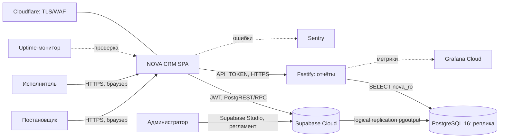
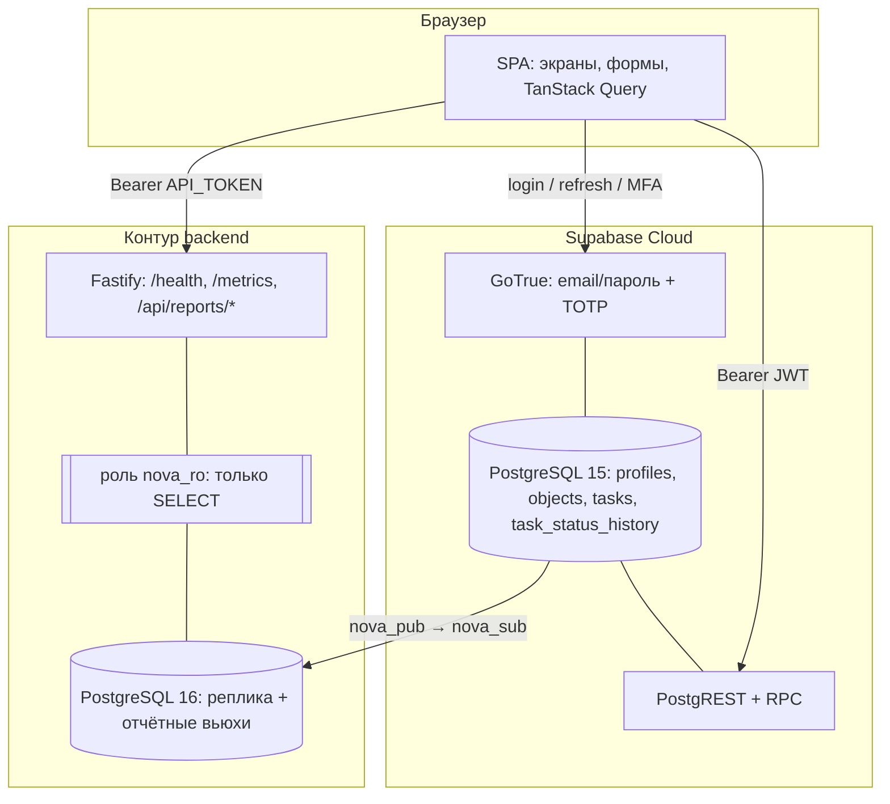
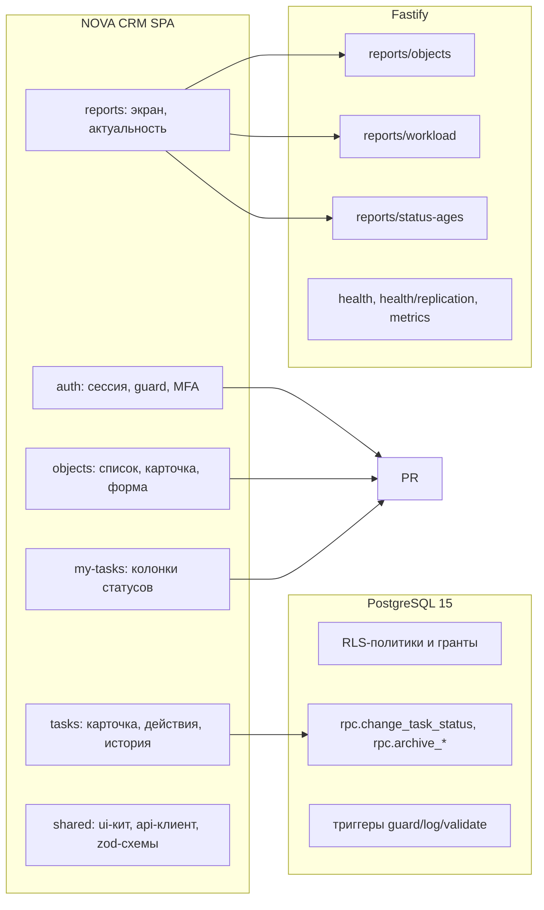
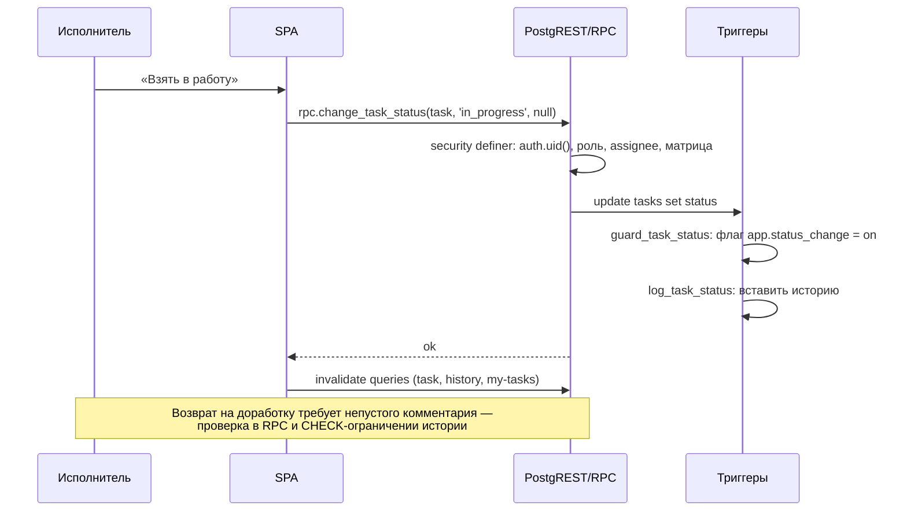
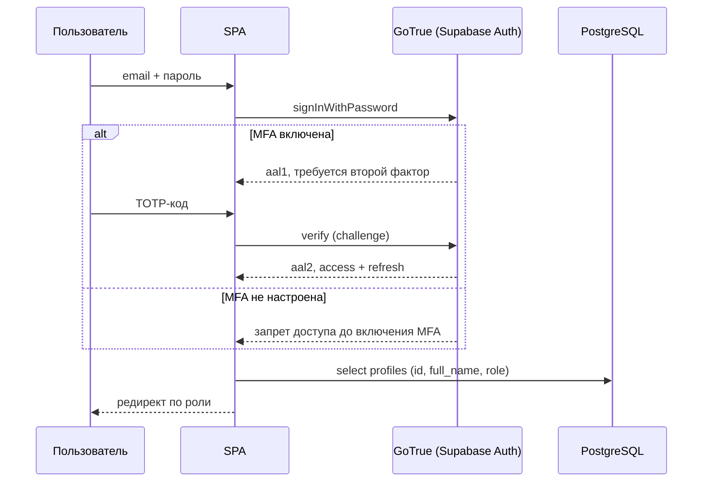
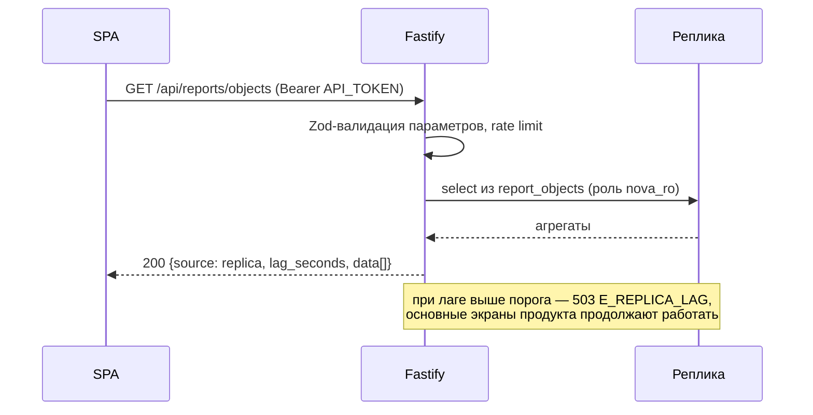

# Архитектура — NOVA CRM

> Сгенерировано Witness Done v1.31.0
> Вход: `INPUT/TECH_SPEC.md`, `OUTPUT/docs/01_analysis.md`, `AGENTS.md` (конституция).

## 1. Выбор стека

| Слой | Решение | ADR |
|------|---------|-----|
| Frontend | React 18.3 + TypeScript 5.5 `strict`, Vite 5, React Router 6, TanStack Query 5, react-hook-form + Zod, Tailwind 3.4 + Radix UI | ADR-0004 |
| Backend отчётности | Node.js 20 LTS + TypeScript 5.5 `strict`, Fastify 4, `pg`, Zod, pino; **только чтение** | ADR-0001 |
| Основная БД и BaaS | Supabase Cloud: PostgreSQL 15, Auth (email + TOTP), PostgREST, RPC, RLS, триггеры | ADR-0002 |
| Вторичная БД | PostgreSQL 16 в контуре backend, логическая репликация `pgoutput`, роль `nova_ro` (read-only) | ADR-0003 |
| Аутентификация | Supabase Auth, JWT в `Authorization`, MFA обязательна | ADR-0005 |
| Хостинг | Vercel (SPA), Supabase Cloud (primary), Docker Compose (backend + реплика), Cloudflare (TLS/WAF) | ADR-0006 |
| Наблюдаемость | pino + Prometheus/Grafana Cloud, Sentry, uptime-монитор | ADR-0006 |

Почему не «полный собственный API поверх Supabase»: два пути записи означают два источника правды
и удвоенную поверхность атаки; требование «права работают при прямом обращении к Supabase»
несовместимо с параллельным write-API.

## 2. Контекст и стиль

Стиль — **CQRS-lite**: единственный путь записи (Supabase: PostgREST для CRUD, RPC для переходов и
архивирования, RLS и триггеры для прав), отдельный путь чтения аналитики (Fastify → реплика).
Модульный монолит на фронтенде: домен `objects`, `tasks`, `history`, `reports`, `auth` как
изолированные каталоги с публичными index-файлами; дробление на сервисы не даёт преимуществ при
одном разработчике и 30 RPS.

Синхронность: все пользовательские операции синхронные. Очередей, брокеров, WebSocket и Redis нет:
логическая репликация — механизм БД, а не очередь приложения. Аналитическая СУБД не нужна:
три отчётных вьюхи на реплике закрывают отчётность.

## 3. C4-обзор

### 3.1. Система в окружении

### 3.2. Контейнеры

### 3.3. Ключевые модули

## 4. Диаграммы потоков (P0-сценарии)

### 4.1. Смена статуса (исполнитель → приёмка → доработка)

### 4.2. Вход с MFA

### 4.3. Отчёт с реплики

## 5. Границы модулей и публичные контракты

| Модуль | Ответственность | Владеет данными | Публичный контракт | Зависит от |
|--------|-----------------|-----------------|--------------------|------------|
| `auth` (FE) | сессия, guard маршрутов, MFA-шаг, выход | — | `useSession`, `RequireAuth`, `login()`, `logout()` | Supabase Auth |
| `objects` (FE) | список, поиск, создание/правка/архивирование, карточка | — | `ObjectListPage`, `ObjectCardPage`, `useObjects`, `useObject` | PostgREST, RPC `archive_object` |
| `tasks` (FE) | создание задачи, карточка, доступные действия, история | — | `TaskCardPage`, `useTask`, `useHistory`, `useAvailableActions` | PostgREST, RPC `change_task_status`, `archive_task` |
| `my-tasks` (FE) | колонки по статусам, счётчики | — | `MyTasksPage`, `useMyTasks` | PostgREST |
| `reports` (FE) | экран отчётов, индикатор актуальности, деградация | — | `ReportsPage`, `useReport(kind)` | Backend API |
| `shared` (FE) | UI-кит, токены, api-клиент, маппинг ошибок `P040x` | — | компоненты, `apiClient`, `mapDbError` | design-notes |
| `domain-sql` | схема, enum, индексы, RLS, RPC, триггеры | `profiles`, `objects`, `tasks`, `task_status_history` | SQL-контракт: функции и политики | — |
| `replica-infra` | публикация/подписка, роль `nova_ro`, отчётные вьюхи, сверка | вторичная БД | `nova_pub`, `nova_sub`, `report_*`, `check.mjs` | Supabase replication |
| `reporting-api` | три отчёта, health, metrics | — | `GET /api/reports/objects|workload|status-ages`, `/health`, `/health/replication`, `/metrics` | реплика |
| `ops` | мониторинг, алерты, бэкапы, runbooks, релиз | — | дашборды, правила алертов, runbooks | Vercel, Supabase, Grafana |

Правило: модуль читает данные другого модуля только через его публичный контракт (для FE —
через hook с Zod-валидацией ответа; для SQL — через вьюху или RPC, не через прямые `select` к чужим
таблицам из UI-модулей).

## 6. Хранение файлов и медиа

Отсутствует: файлы, фотоотчёты и вложения не входят в продукт (ТЗ §2.2). Это архитектурное
решение, а не незакрытый пункт: объектного хранилища, presigned URL и антивирусной проверки
в системе нет.

## 7. Мультитенантность

Нет. Одна инсталляция — одна компания (ТЗ §2.2). `tenant_id`, схемы на компанию и переключатель
организаций не вводятся; вторая компания получает отдельное развёртывание.

## 8. Наблюдаемость

- **Метрики:** `/metrics` (Prometheus, только внутренняя сеть): `http_requests_total`,
  `http_request_duration_seconds`, `replica_lag_seconds`, `replica_rows_total`,
  `report_cache_hit_total`, `db_pool_*`.
- **Логи:** pino JSON с `request_id`, redact (`authorization`, `cookie`, `access_token`,
  `refresh_token`, `password`); без тел запросов и значений полей.
- **Трассировка:** OTel не подключается; корреляция — `request_id` + Sentry trace.
- **Алерты:** доступность, доля 5xx, p95, лаг репликации > 30 с, ошибки подписки, диск > 80%,
  серия неуспешных входов.
- **Дашборды:** обзор продукта (доступность, p95, 5xx), репликация (лаг, состояние слота, объём
  WAL), backend (RPS, latency, ошибки), безопасность (неуспешные входы, отказы RLS).

## 9. Точки расширения (без изменения объёма поставки)

Архитектура допускает расширение без переделки ядра, но ни одна из точек не является «обещанной
функцией»: появление требует `sp intake --kind change` и нового пакета изменения.

- Новый домен (например, акты) — новая таблица + RLS + RPC, интерфейс не меняет модель статусов.
- Новый отчёт — вьюха на реплике + маршрут API + экран; ядро записи не затрагивается.
- Переход на BFF с httpOnly-cookie — добавляет CSRF-инфраструктуру (§8.7 п. 6 ТЗ), контракты
  Supabase при этом не меняются.
- Публикация отчётного API внешним подрядчикам — отдельный контур с TLS, OAuth/токеном и rate limit.

## 10. Non-goals архитектуры

Не делаем: собственный write-API и ORM поверх PostgREST; очереди, Kafka, Redis, WebSocket и
realtime-подписки; аналитическую СУБД и ETL; мультирегион и автоматический failover; продвижение
реплики в primary; микросервисы; серверный рендеринг и SSR-кэш; мобильное приложение; хранение
файлов; UI-администрирование пользователей; i18n и светлую тему.
