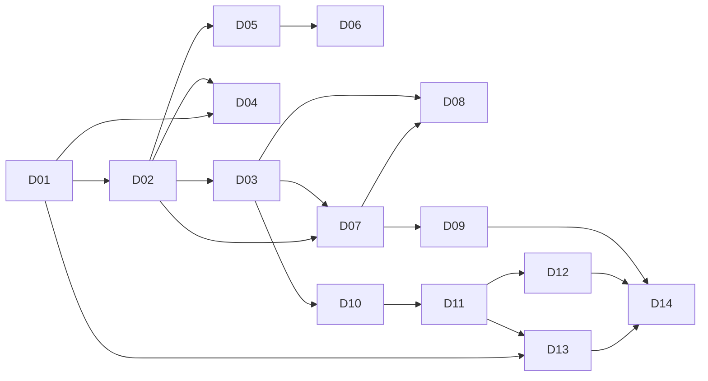

# Граф зависимостей D

> Генерируется на шаге 09, сверяется с `ЗАВИСИТ ОТ` в каждом D и с PRE-CHECK.
> Правило: если D_n читает ключи/схему D_m — ребро обязательно, а в PRODUCES D_n есть
> snapshot/fixture-тест на эти ключи (`catalogs/verification-tax.md`).

## Рёбра

| От | К | Почему |
|----|---|--------|
| D01 | D02 | миграции запускаются конфигом env и локальным Supabase из D01 |
| D02 | D03 | RPC опирается на таблицы, enum и RLS-помощники D02 |
| D01 | D04 | fetch-клиент, env-контракт и логгер фронта берутся из D01 |
| D02 | D04 | профиль и роль читаются из `profiles`/`current_role()` |
| D02 | D05 | объект — таблица и политики D02 |
| D05 | D06 | экран объекта потребляет схему ответа D05 и его коды ошибок |
| D02 | D07 | задача — таблица/политики D02 |
| D03 | D07 | смена статуса вызывается только RPC D03 |
| D07 | D08 | экран задачи потребляет DTO D07 и его `allowed_transitions` |
| D03 | D08 | панель статусов рисует матрицу из D03 |
| D07 | D09 | очередь исполнителя — фильтр по `assignee_id` из D07 |
| D03 | D10 | вьюхи читают `task_status_history` и `tasks` |
| D10 | D11 | API отчётов читает только `nova_ro` и вьюхи D10 |
| D11 | D12 | экран отчётов потребляет контракт `/api/v1/reports/*` D11 |
| D01 | D13 | метрики/логи подключаются к серверу и процессам D01 |
| D11 | D13 | лаг репликации и деградация отчётов — метрики D11 |
| D13 | D14 | релиз требует работающих алертов и бэкапа |
| D12 | D14 | e2e проходит весь путь до отчётов |
| D09 | D14 | e2e проходит путь исполнителя до приёмки |

## SPLIT_GROUP (волновые маркеры)

| split_group | D | Контурная проверка |
|-------------|---|--------------------|
| `platform` | D01 | `wave-api-smoke.sh platform` |
| `schema` | D02, D03 | `wave-api-smoke.sh schema` |
| `auth` | D04 | `wave-api-smoke.sh auth` |
| `objects` | D05, D06 | `wave-api-smoke.sh objects` |
| `tasks` | D07, D08, D09 | `wave-api-smoke.sh tasks` |
| `reports` | D10, D11, D12 | `wave-api-smoke.sh reports` |
| `release` | D13, D14 | `wave-api-smoke.sh release` |

## Критические пути

- **Доверие к данным:** D02 → D03 → D10 → D11 — любая дыра здесь ломает KPI 3–5.
- **Первый пользовательский результат:** D01 → D04 → D05 → D06 → D07 → D08 → D09.
- **Выпуск:** D13 → D14, но `D14` требует ещё D09 и D12 (e2e покрывает весь путь).

## Запрещённые рёбра

- `D11 → D07` (backend не пишет и не читает primary) — контракт `INV-004`.
- `D04 → D03` (UI не проверяет переходы сам) — матрица живёт в БД, `INV-005`.
